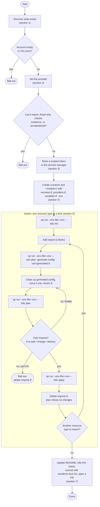
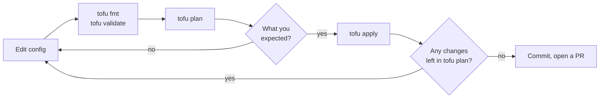

Title: Adding a new OpenTofu provider: the flowchart
Slug: opentofu-new-provider-flowchart
Status: hidden

This is the flowchart for the checklist in [Using OpenTofu to manage your Infrastructure as Code]({filename}/technology/using-opentofu-to-manage-your-infrastructure-as-code.md#a-checklist-for-adding-a-new-provider). The section numbers match the checklist. `op run --env-file=.env --` is 1Password's runner; use your own secrets manager's equivalent.

Every change after that (an edit, a rename, a provider upgrade from section 6) follows the same loop:

