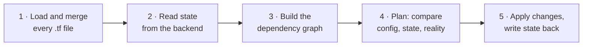

Title: Using OpenTofu to manage your Infrastructure as Code
Date: 2026-11-09
Author: ryan
Tags: iac, opentofu, terraform, infrastructure-as-code
Slug: using-opentofu-to-manage-your-infrastructure-as-code
Series: learnings-on-leave
Status: published

In the [Django Commons](https://github.com/django-commons) organization we use [OpenTofu](https://opentofu.org/) to manage our Infrastructure as Code (IaC).

While we have done this since the very beginning (though we initially started with [Terraform](https://developer.hashicorp.com/terraform) instead of OpenTofu), I was always a bit unsure as to what is actually happening. I decided the best way to understand it was to just dive in, head first, and use it for some of my own personal infrastructure.

> OpenTofu is an open source forked alternative to Terraform version 1.5.6. Why an open source alternative? HashiCorp changed the license from Mozilla Public License (MPL) 2.0 to the Business Source License (BSL) on August 10, 2023. For more, read their [Manifesto](https://opentofu.org/manifesto/).

## Start with what you want to manage

The easiest way to understand OpenTofu is to start with the thing you want to manage and work backwards. At Django Commons that's things like the members and teams of our GitHub organization. For me, it was the servers, firewalls and DNS records I have on Hetzner (and, eventually, a handful of other services).

Once you know *what* you want to manage, you can work out what OpenTofu needs to manage it:

1. A [provider](#provider) to talk to the service
2. The [resources](#resource) you want it to manage
3. Somewhere to keep [state](#state-and-backend), the record of what it manages
4. [Variables](#variable) (and maybe [outputs](#output)) for the values that change or are secret

[Modules](#module) come last, once there's enough that you want to break it into smaller pieces.

### Provider

Providers are connectors. Each one is a plugin that lets OpenTofu create, read, update, and delete resources on a given platform (AWS, GitHub, Hetzner, etc). You write your configuration in a consistent way, and the provider takes care of talking to that platform's API for you. There are a LOT of [providers](https://search.opentofu.org/providers).

For Django Commons managing GitHub members, that's the `github` provider. For my Hetzner servers, it's the `hcloud` provider.

### Resource

Resources are the actual things you're managing ... users, servers, DNS records, firewalls, etc. Per the [docs](https://opentofu.org/docs/language/resources/behavior/):

> In summary, applying an OpenTofu configuration will:
>
> - _Create_ resources that exist in the configuration but are not associated with a real infrastructure object in the state.
> - _Destroy_ resources that exist in the state but no longer exist in the configuration.
> - _Forget_ resources that exist in the state but no longer in the configuration and are referenced in a `removed` block within the configuration.
> - _Update in-place_ resources whose arguments have changed.
> - _Destroy and re-create_ resources whose arguments have changed but which cannot be updated in-place due to remote API limitations.

Each resource type is implemented by a [provider](https://opentofu.org/docs/language/providers/requirements/). You can also change how OpenTofu treats a resource with a `lifecycle` block. Some of the arguments it takes:

- `create_before_destroy`: does what it says, but there are some limitations depending on the API you're interacting with
- `prevent_destroy`: stops OpenTofu from destroying the resource. You'll see me use this below when I set up Hetzner
- `ignore_changes`: useful for things that might change outside of OpenTofu. The example in the docs is tags that get added to a resource at the source
- `enabled`: when set to `false`, OpenTofu acts as if the resource isn't in the configuration at all. If it's already in state, that means it gets **destroyed**. It's tempting to compare this to `managed = False` in Django, but that's nearly the opposite: Django leaves an unmanaged table alone, while OpenTofu deletes a disabled resource
- `destroy`: when set to `false`, removing the resource from the configuration makes OpenTofu *forget* it (drop it from state) instead of destroying the real thing. It works like a [`removed`](https://opentofu.org/docs/language/resources/syntax/#removing-resources) block
- `precondition` and `postcondition`: these "can help capture assumptions, helping future maintainers understand the configuration design and intent" per the [docs](https://opentofu.org/docs/language/resources/syntax/#custom-condition-checks)

A few other things that stood out:

- You can set [operation timeouts](https://opentofu.org/docs/language/resources/syntax/#operation-timeouts)
- You *might* get [deprecation warnings](https://opentofu.org/docs/language/resources/syntax/#deprecation-of-blocks-and-attributes)
- [`terraform_data`](https://opentofu.org/docs/language/resources/tf-data/) is confusing. I asked Claude to explain it, and what made it click was this: `replace_triggered_by` only works with resources, so you can't point it at a plain variable or local. `terraform_data` wraps a plain value in a resource, so changing that value can trigger a replacement. It's also handy as a do-nothing container for provisioners when there's no other resource that makes sense to hang them on.

One last thing on resources. Provisioners run a script or copy files onto a machine after OpenTofu creates it. They [should be used as a last resort](https://opentofu.org/docs/language/resources/provisioners/syntax/#provisioners-are-a-last-resort), and the docs suggest using `cloud-init` instead.

### State and backend

State is how OpenTofu remembers what it manages. Its primary purpose is to store the bindings between objects in a remote system and the resources declared in your configuration. When you run `tofu plan`, OpenTofu compares three things: your configuration, the state, and what actually exists.

The [backend](https://opentofu.org/docs/language/settings/backends/configuration/) is *where* that state lives. If you don't configure one, it's a `terraform.tfstate` file in the directory you run `tofu` from. That's fine for trying things out, but it means the state only exists on your laptop.

Where to keep state was one of the bigger decisions at Django Commons. We started with the state file stored on GitHub, and then [Daniel and Tim set up an AWS backend](https://github.com/django-commons/membership/pull/514) so that everyone on the team works from one shared state file.

For my own infrastructure I started with local state, and then moved it to an S3 backend. Every directory ([root module](#module)) gets its own state file in the same bucket:

```hcl
terraform {
  backend "s3" {
    bucket       = "ryancheley-tofu-state"
    key          = "hetzner/terraform.tfstate"
    region       = "us-west-2"
    use_lockfile = true
  }
}
```

The bucket is versioned, so a bad state write can be undone by restoring an older version, and `use_lockfile = true` stops two runs from writing state at the same time. Changing the backend means running `tofu init -migrate-state`, which copies the existing state to the new location.[ref]There's a fun chicken-and-egg problem here: the bucket itself is managed by my `aws` module, which also keeps its state in that bucket. If the bucket ever disappears, the `aws` module has to fall back to local state long enough to recreate it.[/ref]

A couple of other things on state:

- `import` is how you bring in [existing resources](https://opentofu.org/docs/language/import/). This is what I ended up using for my own infrastructure
- [Workspaces](https://opentofu.org/docs/language/state/workspaces/) let one configuration have more than one state. Despite what a [video I watched](https://youtu.be/BZ2TLtf3yFg?si=un-QoHhEaZyiHYwq) implied, they aren't meant for separate environments (separate directories like `envs/prod` and `envs/staging` are). Neither Django Commons nor I use them

The [`terraform_remote_state` docs](https://opentofu.org/docs/language/state/remote-state-data/#example-usage-remote-backend) look scary at first. I initially read them as a lot of "You can do this, but you shouldn't." The concern is that `terraform_remote_state` exposes the entire state file, which can include secrets that another team maybe shouldn't have access to. This is one of those questions of: will my current setup ALWAYS be just me and NEVER change? If the answer is yes, then this is a perfectly acceptable way to proceed ... but remember, ALWAYS and NEVER are very long times.

### Variable

Input variables are like function arguments. Some things I learned about them:

- You can [add a description](https://opentofu.org/docs/language/values/variables/#input-variable-documentation) which acts like a doc string for the variable
- Setting `sensitive = true` will keep the value out of the `plan` and `apply` output
- Be careful though ... errors can [leak](https://opentofu.org/docs/language/values/variables/#cases-where-opentofu-may-disclose-a-sensitive-variable) these sensitive values
- Ephemeral variables are available by setting `ephemeral = true`

I wasn't sure when I'd use an ephemeral variable instead of a sensitive one, so I asked Claude. Ephemeral variables are for secrets that OpenTofu needs while it runs but should never write down. Their values aren't stored in state at all, and only the variable *names* are saved in the plan. A sensitive value, on the other hand, is still stored in state and in saved plan files. Only the display is masked. I had assumed they did the same thing!

You can set variables individually on the command line, or put them in a `*.tfvars` file to read from. This feels a lot like `docker` with flags vs. docker compose with a `docker-compose.yml` file. OpenTofu will also automatically load variable definition files if they're present:

- Files named exactly `terraform.tfvars` or `terraform.tfvars.json`
- Any files with names ending in `.auto.tfvars` or `.auto.tfvars.json`

If the same variable is assigned more than once, OpenTofu uses the _last_ value it finds. See the [docs](https://opentofu.org/docs/language/values/variables/#variable-definition-precedence) for the full precedence order.

### Output

Per the [docs](https://opentofu.org/docs/language/values/outputs/):

> Output values make information about your infrastructure available on the command line, and can expose information for other OpenTofu configurations to use. Output values are similar to return values in programming languages.

You can use `precondition` and `postcondition` here too, and there's a `depends_on` key that works a lot like it does in docker compose.

### Module

Modules are how you group resources together, and they're what you reach for once a configuration gets big enough that you want to break it into smaller pieces. Every OpenTofu configuration has at least one module, known as its [root module](https://opentofu.org/docs/language/modules/#the-root-module). This is just the resources defined in the `.tf` or `.tofu` files in the directory you're running `tofu` from. For my own setup, each provider gets its own directory, so each one is its own root module with its own state.

Here's what grouping looks like. A `web_server` module could bundle a server with the firewall it always needs:

```hcl
# modules/web_server/main.tf
variable "name" {
  type = string
}

resource "hcloud_firewall" "this" {
  name = "${var.name}-fw"

  rule {
    direction  = "in"
    protocol   = "tcp"
    port       = "443"
    source_ips = ["0.0.0.0/0", "::/0"]
  }
}

resource "hcloud_server" "this" {
  name         = var.name
  server_type  = "cx22"
  image        = "ubuntu-24.04"
  firewall_ids = [hcloud_firewall.this.id]
}
```

Then each new server is a few lines in the root module:

```hcl
module "blog" {
  source = "./modules/web_server"
  name   = "blog"
}

module "status_page" {
  source = "./modules/web_server"
  name   = "status-page"
}
```

A couple of things I noticed:

- Only provider *configurations* are inherited by child modules, not provider source or version requirements. Each module has to [declare its own provider requirements](https://opentofu.org/docs/language/providers/requirements/). This is especially important for non-HashiCorp providers.
- When you've outgrown your initial configuration, check out [Refactoring](https://opentofu.org/docs/language/modules/develop/refactoring/) in the docs

---

## Using OpenTofu to manage my own infrastructure

To help solidify what I'd learned, I decided to use OpenTofu to manage my own infrastructure. For that I used the following providers:

- AWS
- Coolify
- DigitalOcean
- GitHub
- Hetzner
- Tailscale

In my case I'm importing what I already have, not adding new things (yet!).

Here's a quick walkthrough of setting up Hetzner with OpenTofu:

1. Created an `infra` directory, and then a `hetzner` directory inside of it
2. Created `main.tf` and added the Hetzner provider
3. Ran `tofu init`
4. Created `imports.tf` to catalog all of the infrastructure I wanted to import
5. Ran `tofu plan -generate-config-out=generated.tf`, which created `generated.tf`. I did have to set the `HCLOUD_TOKEN` environment variable first with `set -x HCLOUD_TOKEN (op read "op://token-location")`[ref]I did get a scary warning: "Note: You didn't use the -out option to save this plan, so OpenTofu can't guarantee to take exactly these actions if you run "tofu apply" now." It seems to be directed more at teams, where something may change between the `plan` and the `apply`. Since it's just me, there's little risk here.[/ref]
6. Updated each server with a `lifecycle` block to prevent any accidental destruction:

    ```hcl
    lifecycle {
      ignore_changes  = [image, user_data, ssh_keys]
      prevent_destroy = true
    }
    ```

7. Ran `tofu apply` to bring everything into state
8. Later, moved the state from a local file to the S3 backend described [above](#state-and-backend)

Some caveats:

1. For Hetzner, make sure every server has `prevent_destroy = true` (see step 6 above). You do NOT want a typo to delete a server
2. For Tailscale, import your ACL policy and use `tailscale_device` data sources for your machines (all ten in my case). Be careful though ... a bad policy can lock you out of your machines[ref]I actually saw this manifest on my Coolify server when it couldn't reach any of the servers via Tailscale any longer. It was a quick fix, but there was a bit of "Oh SHIT!" when Coolify stopped being able to interact with my hetzner servers![/ref]
3. Don't let Coolify create Hetzner servers, as they will collide with the `hcloud` provider

### Encrypting my state

This part is specific to my setup. Django Commons doesn't encrypt its state (we use 1Password there to manage access to AWS).

State holds everything OpenTofu knows about your resources, and depending on the provider that can include secrets, so I wanted mine encrypted. OpenTofu has [native state encryption](https://opentofu.org/docs/language/state/encryption/) built in, which is one of the things it has that Terraform doesn't. I added an `encryption` block to the `terraform` block:

```hcl
terraform {
  encryption {
    key_provider "pbkdf2" "main" {
      passphrase = var.state_passphrase # at least 16 characters
    }
    method "aes_gcm" "main" {
      keys = key_provider.pbkdf2.main
    }
    state {
      method   = method.aes_gcm.main
      enforced = true
    }
    plan {
      method   = method.aes_gcm.main
      enforced = true
    }
  }
}
```

Along with a `state_passphrase` variable (marked `sensitive`). The passphrase lives in 1Password, and I pass it in as `TF_VAR_state_passphrase` with `op run`. `enforced = true` means OpenTofu will refuse to write state or plans unencrypted.

This was a [pita](https://www.merriam-webster.com/slang/pita) because I had already imported everything, so my state file was sitting there unencrypted, and OpenTofu won't read it once you've told it everything should be encrypted. To migrate it I had to:

1. Back up `terraform.tfstate` (just in case!)
2. Remove `enforced = true` for now. While it's set you get "Unable to use unencrypted method since the enforced flag is set."
3. Add a temporary `method "unencrypted" "migrate" {}` and a `fallback { method = method.unencrypted.migrate }` inside both `state` and `plan`. This lets OpenTofu read the plain state one last time
4. Run `tofu apply -refresh-only`, then check with `grep -c encrypted_data terraform.tfstate`. If it prints 1, the state is encrypted
5. Remove the `unencrypted` method and both `fallback` blocks, put `enforced = true` back, and make sure `tofu plan` reports "No changes"

A few gotchas:

- Plain `tofu init` stops working. The encryption block needs the passphrase, so even `init` has to run through `op run`
- Don't lose the passphrase! Without it, the state is unreadable. Same goes for removing the `encryption` block later ... treat it as permanent
- Keep the passphrase in its own 1Password item. If you add it as an extra field on, say, the Hetzner API token's item, then replacing that item when you rotate the token takes your state key with it

If I were doing this again (which I did for every other provider after Hetzner), I'd turn encryption on *before* the first import and skip the whole migration dance.

### Does the order of the files matter?

As things evolved, I refactored from having just `main.tf` and `generated.tf` to having the following `*.tf` files:

- `dns.tf`
- `firewalls.tf`
- `primary_ips.tf`
- `providers.tf`
- `rdns.tf`
- `servers.tf`
- `ssh_keys.tf`
- `variables.tf`
- `versions.tf`
- `zones.tf`

Each one is named for the resources it's managing. This led me to wonder:

> When I run `tofu plan` or `tofu apply`, what order do the `*.tf` files get processed in? Does it matter what I name them?

I did some research, and also asked Claude. Names don't affect the order. OpenTofu loads every `.tf` file in the directory, merges them into one configuration, and then works out the order from the references between blocks.

A little more detail on how that works:

- When you run `tofu plan` or `tofu apply`, it reads every `.tf` and `.tf.json` file in the current directory. It does NOT read subdirectories
- It reads the files alphabetically, but that has no effect on the result. All of the blocks are merged as if they were in one file
- It then builds a dependency graph from the references between blocks. If `hcloud_server.webp1` uses `hcloud_firewall.firewall.id`, the firewall is handled first, no matter which file each one is defined in. Resources that don't depend on each other run in parallel, 10 at a time by default
- If the graph misses a dependency, you add `depends_on`. My Tailscale config does this so the ACL is applied before the auth key. Renaming or reordering files will never fix ordering

Here's the overall flow of a `tofu plan` or `tofu apply`:



This is also why, when I moved my state bucket's configuration from `main.tf` into `s3.tf` as part of my refactor, the plan showed no changes. A resource's address (`aws_s3_bucket.resource_name`) is the same no matter which file it's in.

That said, there are a few cases where file names DO matter:

- **Override files**: files named `override.tf` or ending in `_override.tf` are loaded last. Their blocks are merged into blocks with the same name instead of being treated as duplicates. Avoid these unless you really mean to use them
- **`.tofu` files**: OpenTofu also reads `.tofu` and `.tofu.json` files. If `foo.tofu` and `foo.tf` both exist, it uses `foo.tofu` and ignores `foo.tf`
- **Test files**: `.tftest.hcl` and `.tofutest.hcl` files are only used by `tofu test`
- **Ignored files**: editor temp files (names ending in `~` or wrapped in `#...#`) are skipped, as is any other extension. My Tailscale `policy.hujson` only gets read because I load it with `file()`
- **Duplicates**: a block defined twice is an error, no matter which files the two copies are in

## A checklist for adding a new provider

After doing this for six providers, I wrote up a checklist so the next one doesn't involve rediscovering the same gotchas. It assumes you're adopting infrastructure that already exists, and that each provider gets its own root module with its own state. Each section starts with its **Bail out** criteria, so you can stop before doing work you'll throw away.

`tofu` commands run through `op run --env-file=.env --`, which is 1Password's runner; use your own secrets manager's equivalent.

### 1. Discover what exists

**Bail out** if the account is empty and you don't want a placeholder module, or if the account isn't yours. Infrastructure that belongs to an employer or an organization you volunteer for goes in that organization's repo.

#### Take inventory

- Check that your local credentials still work. A CLI that returns 401 may have a stale token, so get a fresh one before concluding anything.
- List every resource type with read-only calls. Use the service's CLI or API, or the provider's own list data sources in a temporary `discover.tf` with an `output`. For Hetzner:

    ```hcl
    data "hcloud_servers" "all" {}

    output "servers" {
      value = [for s in data.hcloud_servers.all.servers : { id = s.id, name = s.name }]
    }
    ```

    Run `op run --env-file=.env -- tofu apply` (it only adds the output), then `tofu output -json servers`. Keep the output to IDs and names like this, and mark it `sensitive = true` if you need fields that hold secrets. Delete `discover.tf` afterwards; its outputs stay in state until the next apply removes them.
- Note IDs, names, and how each resource relates to others (which project, server or app it belongs to). Note which resources are defaults the service creates for you.

#### Decide what to manage

- Skip defaults the service won't let you delete (default VPCs, default projects), empty accounts and leftover test resources. Records the service manages itself, like DNS `SOA` and `NS` records, stay out too.
- Decide which tool owns each resource. Two providers managing the same thing fight each other. For example, if one provider creates your servers, a deployment platform's provider should only register them. Resources another system creates become `data` sources.
- Note anything the provider can't manage, such as OAuth clients, consent screens or key material. Those stay manual, or you reference them as `data` sources. Bare-metal hardware and what runs inside machines belong to a configuration tool like Ansible.

### 2. Vet the provider

**Bail out** if the important resources can't be imported, `Read` only checks that the resource exists, or the provider is unmaintained. Check these first:

- Find it on [search.opentofu.org](https://search.opentofu.org/). If it isn't there, check the [Terraform registry](https://registry.terraform.io/browse/providers) or search GitHub for `terraform-provider-<name>`. A service with no public API can't have a provider.
- Check maintenance: last release, last commit, open issues, and whether the repo is archived.
- Check import support in the provider source with `grep -rln ImportState --include='*.go'`. The docs often leave it out.
- For the resources that matter most, read `ImportState` and `Read`:
    - Does `ImportState` set every attribute that `Read` needs, such as the name?
    - Does `Read` refresh attributes, or only check that the resource exists? If it only checks existence, OpenTofu can't detect drift.
    - Does `Read` return parent IDs (project, server)? If not, imports generate them as `null` and you fill them in by hand.

Then note these, since they shape how you write the config:

- A `replace` directive in `go.mod` means the provider builds against someone's fork. Pin the version of anything pre-1.0.
- Check which credentials the provider reads. Environment variables or Tofu variables let you inject them from a secrets manager instead of writing them to disk.
- Check whether the provider has several resource types for the same thing (for example, one per app source). The type has to match how the resource was created, or the plan forces a replacement.
- Check whether the provider offers several ways to express one relationship (for example, attaching a firewall from the server, from the firewall, or with a separate attachment resource). Pick one; two describing the same link cause a permanent diff.

### 3. Set up credentials

#### Create the token

- Store the credentials in a secrets manager. Use a dedicated token with the minimum permissions the provider needs. A CLI login token (like `gh auth token`) has the access of your whole login and gets replaced when you log in again, which leaves the stored copy stale.
- Give the token read access to sensitive fields if the provider compares them. With redacted reads, every plan shows phantom diffs. Avoid root or admin scopes the provider doesn't need.
- If the provider warns about token permissions, work out what the token can actually read. A token that can read config files can read the secrets in them, and imported values land in state. That's a reason to encrypt state.
- Keep the state passphrase in its own secrets-manager item. If it's an extra field on a provider's token item, replacing that item when you rotate the token takes the state key with it.

#### Use it safely

- Test the credentials once, interactively or with a single API call, before using them from OpenTofu. Don't retry failed logins blindly. Some services, Synology DSM among them, block an IP after repeated failures.
- Never print secret values. To debug, print only their shape:

    ```sh
    op read "op://Private/Example OpenTofu/token" | wc -c                           # length (+1 for op's trailing newline)
    op read "op://Private/Example OpenTofu/token" | sed 's/[^[:space:]]/*/g' | cat -et  # stray spaces show before the $
    ```

- Don't export credentials in your shell, and never in persistent shell variables (fish universal variables are stored in plain text). Inject them per command with your secrets manager's runner. With 1Password, `op run --env-file=.env` reads `op://` references from a `.env` file (section 4) and resolves them for that one command only.
- Remove anything that overrides the environment: a `profile = ...` in the provider block, entries in `~/.aws/credentials`, exported shell variables. Providers prefer those over the injected values. Run the CLI the same way when you need it: `op run --env-file=.env -- aws sts get-caller-identity`.

### 4. Scaffold the module

#### Files

- Create a branch for the work.
- Name the directory after the provider, in lowercase (`hetzner/`, `digitalocean/`).
- Split the config across `versions.tf`, `providers.tf` and `variables.tf`. Use the same names in every module, and skip `main.tf`, so you always know where to look.

    `versions.tf` holds the OpenTofu and provider versions, the backend, and the state encryption. Turn encryption on now, before the first import; migrating existing unencrypted state is the dance from [Encrypting my state](#encrypting-my-state).

    ```hcl
    terraform {
      required_version = ">= 1.10"

      required_providers {
        example = {
          source  = "example-org/example"
          version = "~> 1.4"
        }
      }

      backend "s3" {
        bucket       = "my-tofu-state"
        key          = "example/terraform.tfstate"
        region       = "us-west-2"
        use_lockfile = true
      }

      encryption {
        key_provider "pbkdf2" "main" {
          passphrase = var.state_passphrase
        }
        method "aes_gcm" "main" {
          keys = key_provider.pbkdf2.main
        }
        state {
          method   = method.aes_gcm.main
          enforced = true
        }
        plan {
          method   = method.aes_gcm.main
          enforced = true
        }
      }
    }
    ```

    `providers.tf` holds the provider blocks. Leave them empty and let credentials come from the environment:

    ```hcl
    provider "example" {}
    ```

    `variables.tf` holds every variable, starting with the passphrase:

    ```hcl
    variable "state_passphrase" {
      type      = string
      sensitive = true
    }
    ```

    Each module uses the same bucket with its own `key`. Pin the provider with `~>` to the major and minor version you install, so a new release can't change behaviour without you noticing.

- Add one aliased `provider` block per extra region (for AWS, a second `provider "aws"` with `alias = "use1"` and `region = "us-east-1"`). A resource in another region needs `provider = aws.use1` on both its import block and its resource.
- Keep `required_providers` and each default `provider` block in exactly one file. A second copy is a "Duplicate provider configuration" error.

#### Secrets

- Create a gitignored `.env` that holds `op://` references, not the secrets themselves. `op run` resolves them at run time (see section 3):

    ```sh
    EXAMPLE_TOKEN=op://Private/Example OpenTofu/token
    TF_VAR_state_passphrase=op://Private/OpenTofu State/passphrase
    ```

    If a `.env` already exists, add to it instead of overwriting it. Tools like direnv may also load a file named `.env` and set the literal `op://` strings as values.
- Make sure `.gitignore` covers `.env`, `.terraform/`, `*.tfstate`, `*.tfstate.*` and `*.tfplan`.

#### First run

- `op run --env-file=.env -- tofu init`, then `tofu fmt -check && tofu validate`. `init` needs `op run` too: the encryption block reads the passphrase variable, and without it init fails with "depends on var.state_passphrase which is not available". Re-run `init` whenever `required_providers`, the backend or encryption changes; `init -upgrade` to move to a newer provider version.
- `op run --env-file=.env -- tofu plan` should report "No changes". An empty plan doesn't log in, so the first import is the real auth test.
- Prove the plan uses only the secrets manager: unset exported variables (`env -u VAR`), hide CLI config files (`AWS_SHARED_CREDENTIALS_FILE=/dev/null`), and block CLI fallbacks (`GH_CONFIG_DIR=$(mktemp -d)` stops the GitHub provider using your `gh` login).
- Commit `.terraform.lock.hcl` so every machine installs the same provider version.

### 5. Import resources

**Bail out** if the plan wants to replace or modify resources you can't safely ignore, or if the provider errors on import. Delete `imports.tf` and check with `tofu state list` that nothing was written to state.

#### Write the import blocks

- Write `imports.tf` with one `import {}` block per resource:

    ```hcl
    import {
      to = example_ssh_key.laptop
      id = "12345678"
    }
    ```

    Check the import ID format in the provider's `ImportState`, because it may be a numeric ID, a UUID, a name or a composite (such as `zone/name/type` for DNS record sets).
- Pick resource names (the label after the type) by one rule and stick to it:
    - `this` for singletons the account has only one of (an ACL, DNS preferences).
    - Otherwise, the snake_case form of the real-world name, so `example_bucket.my_backups` for a bucket called `my-backups`. Avoid nicknames and generic labels like `server` or `firewall`; they stop making sense once there's a second one.
    - DNS records: `<zone>_<record>_<type>`, such as `example_www_cname`.

    Names are hard to change later: renaming one in state takes a `moved {}` block.
- For many resources, generate the import blocks with a loop over the CLI's list output. Resource names can't contain dots, `@` or `*`, or start with a digit, so sanitize them (a prefix like `r_`, punctuation to `_`).
- Start with low-risk resources and do one resource type at a time. Leave production resources (servers, VMs) until the low-risk imports come back clean.

#### Generate the config

- Run `op run --env-file=.env -- tofu plan -generate-config-out=generated.tf`, but don't apply yet.
- The output file must not already exist, and OpenTofu writes it even when the plan fails. If the plan errors, edit `generated.tf` to fix the errors and run a plain `tofu plan`, rather than deleting it and generating it again.
- If an import fails with "Cannot import non-existent remote object", the provider is looking in the wrong place: check the resource's region, the provider alias, and which account the credentials belong to (`aws sts get-caller-identity` for AWS). If those are right, plan again; it can be transient.
- Commit the generated config before editing it with a script, so the edit is easy to review and undo.

#### Clean up the generated config

- Remove empty strings (`""`) that fail validation.
- Remove computed or read-only attributes.
- Remove one of each pair of mutually exclusive attributes the generator writes together (AWS S3 buckets get both `bucket` and `bucket_prefix`).
- Look for stale values, such as an old download URL or version, that would change the real resource if applied.
- Fill in parent IDs that came back `null` by looking them up in the service's API, and add them to `ignore_changes`. Some force replacement if they differ.
- Remove sensitive fields (webhook secrets, passwords) and add them to `ignore_changes`. A generated `null` would wipe the real value on apply.
- Leave config that contains literal secrets (like a compose file with a password in it) in the source system: use a placeholder value and `ignore_changes`.
- Set JSON-string attributes to the exact string the API returns. `jsonencode()` sorts keys, which shows up as a diff when the provider compares raw text.
- Give read-only resources (archived GitHub repos, for example) `lifecycle { ignore_changes = all }`. The API rejects updates to them anyway.
- If an attribute the provider fills with a default would cause a diff, put it in `lifecycle { ignore_changes = [...] }` with a comment explaining why. For each ignored field, the service's UI is now the source of truth.
- Split the config into one file per resource type, named in plural snake_case (`ssh_keys.tf`, `projects.tf`, …). Delete the `# __generated__` header comments, run `tofu fmt` (generated config isn't always formatted), and delete `generated.tf`.

#### Plan and apply

- Plan again. With many resources, group the remaining diffs by attribute to see which fixes clear the most, and check whether the drifting resources share something, such as all being archived.
- Apply only when the plan shows N to import, 0 to add, 0 to change, 0 to destroy, with no "must be replaced" lines.
- If the plan shows resources "to add" that you know exist, OpenTofu isn't reading your state (wrong workspace, missing or unreadable state file). Don't apply; it would create duplicates.
- `op run --env-file=.env -- tofu apply`
- Delete `imports.tf`. After the apply, the resources are in state and the import blocks do nothing.
- `tofu plan` should report "No changes".

### 6. Change and clean up (optional)

#### Before you start

- Run `tofu plan` and deal with any pending changes first so they don't mix with yours.
- Protect resources you can't lose with `lifecycle { prevent_destroy = true }`, plus the service's own protection where it exists (such as Hetzner's `delete_protection`). Turn off settings that delete resources as a side effect, such as auto-delete on IP addresses. Removing a resource block from config destroys the resource.

#### Making changes

- Swap hardcoded IDs and IPs for references to other resources. The plan should still show no changes.
- To rename a resource that's already in state, add a `moved {}` block instead of a new import.
- Some settings aren't standalone objects (reverse DNS is often a setting on an IP), so there's nothing to import; you create the resource and it overwrites the current value.
- Don't change the same object twice in one apply. Some APIs run one action per object at a time and reject the second with a 409 conflict. A failed apply may still have made the change, so check the service, then import the resource instead of creating it again.
- If an apply hangs, press Ctrl-C once so OpenTofu releases the state lock. Pressing it twice can leave the lock behind.
- After changing access control (ACLs, tags, firewall rules), test the systems that depend on it, not just the plan. In Tailscale, for example, tagging a device removes it from `autogroup:member`, so rules that allowed members stop applying to it.

#### Deleting things

- To delete a resource that's now managed, remove it from config and run plan. Read the destroy plan before applying, because deletes can't be undone. Check what's inside first; a bucket may hold another project's state.
- Delete config files that are now empty.

### 7. Document and ship

- Add the module to your README: what it manages and which environment variables its `.env` needs.
- Write down the provider quirks you hit (ignored fields, defaults you left unmanaged, import gotchas) so the next import doesn't rediscover them.
- `tofu fmt -check` in the module.
- Commit, open a pull request, and merge once checks pass.

If you'd rather see it as a picture, here's the [whole process as a flowchart]({filename}/pages/opentofu-new-provider-flowchart.md).

## Conclusion

This was one of those processes where I ended up going **really** deep [down a rabbit hole](https://en.wikipedia.org/wiki/Down_the_rabbit_hole) or two. BUT, I did learn a lot and now feel more comfortable with the OpenTofu process within Django Commons, which was my goal at the start.

## Thanks

A big thank you to [Daniel Moran](https://github.com/cunla) and [Tim Schilling](https://mastodon.social/@CodenameTim) for reviewing an earlier draft of this post. Their feedback was invaluable. Any mistakes that remain are my own.
